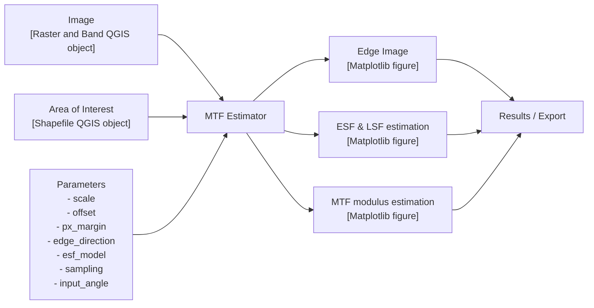
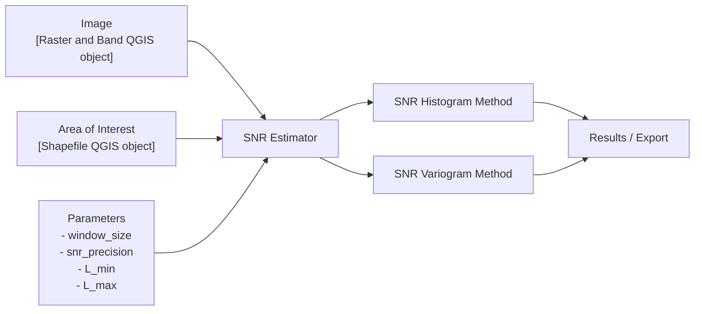

# Image Quality Toolset — MTF & SNR Computation

## Abstract

> *EDAP Image Quality Toolset: Supporting the Monitoring of Level-1 Image Quality Performance*
>
> Saunier Sébastien¹, Romain Degoul¹, Charlotte Broussou¹, Leonardo De Laurentiis²
> ¹ Telespazio France · ² ESA/ESRIN, Italy

A fundamental function of an optical remote sensing sensor relies on its ability to discern ground objects in agreement with Earth Observation mission design specifications. In the community, this notion is addressed by using spatial resolution analysis techniques.

From user perspective, analysis requires a good knowledge of Level 1 data quality metrics.

Building on the knowledge and experience gained in Image Quality analysis within the framework of the EDAP / EDAP+ project [[1]](#ref-1), best practice documents [[2]](#ref-2), [[3]](#ref-3), [[4]](#ref-4), and also inter comparison exercise activities made with CEOS members [[5]](#ref-5), the idea of developing an open-source tool dedicated to image quality analysis emerged.

A key advantage of this product is its operational flexibility, as it can be used either through the graphical interface of Quantum Geographic Information System (QGIS) or via a command-line interface. It has been developed for remote sensing Calibration / Validation users as a supporting tool for Quality Control (QC) of satellite image.

An advantage of this tool is to generate standardized MTF/SNR reports that can be shared across the community and understood at a broader scale.

The Image Quality Toolset was inspired by the QGIS MTF Tool [[7]](#ref-7), as the goal was to enable operators to assess product performance efficiently and consistently.

---

## 1. Overview

The Image Quality Toolset is a QGIS plugin developed in the context of the ESA **AI4QC** project. It is an open-source plugin interfacing with the Quantum Geographic Information System (**QGIS**) software, aimed at computing image quality metrics to establish sensor performance. It has been developed for remote sensing Calibration / Validation users as a supporting tool for Quality Control (**QC**) of satellite image.

It provides a QGIS plugin and a command-line interface to perform image quality assessments from Regions of Interest (**ROIs**) defined on an input image. ROIs are processed to derive Modulation Transfer Function (**MTF**) and Signal-to-Noise Ratio (**SNR**) related image quality measures. Results can be exported / saved into a standardised report.

Three methods are available:
- **MTF Knife Edge Method**
- **MTF Bridge (Pulse) Method**
- **SNR Variogram Method**

Both usage modes share the same underlying algorithms:

| Mode | Entry point |
|---|---|
| QGIS Plugin | Processing Toolbox → ImageQualityToolset |
| Command Line | `image_quality_toolset/scripts/mtf_computer.py` |

> **Note:** In QGIS, the ROI is a polygon vector layer (shapefile, GeoPackage, temporary layer…). The command line interface additionally allows defining an ROI using pixel coordinates (crop window).

---

## 2. Algorithms

### 2.1 Knife Edge MTF

The MTF Knife Edge method estimates the Modulation Transfer Function of an image displaying a sharp image transition between two uniform areas (as close as possible to a step edge function).

- **MTF Estimator**:

The processing workflow follows these steps:

| Function | Description |
|---|---|
| Pre Processing | Conversion to radiance; Configuration checking |
| Edge Modelling | Determine the location of the edge and its angle with respect to the Along-track (AL) and Across-track (CT) directions |
| Edge Spread Function (ESF) construction | Compute oversampled ESF (non-equally spaced); Apply selected ESF model |
| Calculation of MTF | Compute LSF (numerical differentiation); Normalize LSF; Fast Fourier Transform on the normalized LSF |
| Reporting | Spatial Resolution Analysis report (PNG file x2); GeoPackage (.gpkg) |



Several quality metrics are derived from the ESF, including SNR of the method, Relative Edge Response (RER), Half Edge Extent (HEE), and the R2 error. The interpolated ESF is then differentiated to obtain the Line Spread Function (LSF). From the LSF, the Full Width at Half Maximum (FWHM) is computed. Finally, a Fast Fourier Transform (FFT) is applied to the LSF to obtain the MTF. From the resulting MTF curve, several metrics are extracted, including MTF at Nyquist frequency, MTF at 30% frequency, and MTF at 50% frequency.

#### ESF Models — Parametric fitting

| Model | Key | Description |
|---|---|---|
| Sigmoid | `sigmoid` | Standard sigmoid function |
| Hyperbolic tangent | `esf_tanh` | tanh-based model |
| Fermi function | `esf_fermi` | Fermi-Dirac distribution |
| Gaussian exponential | `esf_gauss_exp_param` | Parametric Gaussian-exponential model |
| Erf | `esf_erf` | Gaussian Error Function |

#### ESF Models — Non-parametric fitting

| Model | Key | Description |
|---|---|---|
| Loess | `esf_loess` | Local polynomial regression combining local regression models |
| Polynomial | `esf_to_eq_space_polynomial` | Polynomial regression model |

### 2.2 Bridge (Pulse) MTF

Uses a pulse ROI: a narrow bright line, or "bridge", on a uniform background (as close as possible to a Dirac function). Same processing as the Knife Edge method, except that the profile is modelled as a pulse of known width (`Bridge width`) with a polynomial ESF model. The bridge orientation is estimated automatically, or given as `Input rotation angle`.

In QGIS it is the **Bridge Method MTF** algorithm; on the command line, `method = MTF_BRIDGE`.

### 2.3 SNR Estimator

- **SNR Estimator**:

The SNR Method computes SNR at the mean image radiance. It combines a SNR Histogram method with a SNR Variogram method. The Variogram method is more complex but provides more consistent SNR results.

Pre-processing involves conversion from digital number to radiance and configuration checking.



As reporting, beside a GeoPackage file, a panel figure is generated displaying:
- Selected ROI Image
- Image Histogram plot
- SNR Histogram plot
- Variogram plot

---

## 3. Installation

### 3.1 Requirements

- QGIS **3.38 or later**, including QGIS 4.
- Windows (x64), Linux (x64) or macOS (Apple Silicon or Intel, macOS 11 or later).
- Nothing else: the Python dependencies of the plugin are installed automatically.

### 3.2 QGIS Plugin — Automatic Installation

The plugin and its dependencies install without any command line, `pip` or Python setup. There are two ways to install it.

> **Important — install the plugin only once.** Choose **one** of the two methods below. Both install the same plugin (**ImageQualityToolset**) in the same plugins folder, so installing it a second time with the other method replaces the first installation, possibly with another version. To switch from one method to the other, first uninstall the plugin (**Plugins → Manage and Install Plugins… → Installed → ImageQualityToolset → Uninstall Plugin**), restart QGIS, then install it again.

#### 3.2.1 From the official QGIS plugin repository (recommended)

The plugin is published on [plugins.qgis.org](https://plugins.qgis.org/plugins/image_quality_toolset/). New versions are available there once the QGIS team has approved them.

1. In QGIS, go to **Plugins → Manage and Install Plugins… → All**.
2. Search for **`MTF`**, **`Image Quality`** or **`SNR`**, select **ImageQualityToolset** and click **Install Plugin**.
3. At first start, the plugin downloads and installs its dependencies; progress is shown in the results panel on the right.
4. Open the **Processing Toolbox** (**Processing → Toolbox**, or `Ctrl+Alt+T`) and type **`MTF`** or **`SNR`** in its search bar: the algorithms appear under **ImageQualityToolset** (Knife Edge, Bridge and SNR methods).

Installed copies are then updated from **Plugins → Manage and Install Plugins… → Upgradeable**.

#### 3.2.2 From the plugin ZIP file (GitHub release)

1. Open the [Releases page](https://github.com/telespazio-tim/qgis-image-quality-toolset/releases) and download **`image_quality_toolset-<version>.zip`** from the assets of the latest release.

   > **Warning:** do not use the **Source code (zip)** archive that GitHub adds to every release: it contains the whole repository, not the plugin, and QGIS fails to load it (`No module named 'qgis-image-quality-toolset-…'`).

2. In QGIS, go to **Plugins → Manage and Install Plugins… → Install from ZIP**, select the downloaded file and click **Install Plugin**.
3. As with the QGIS plugin repository, the dependencies install at first start, and the algorithms are found by typing **`MTF`** or **`SNR`** in the Processing Toolbox.

Use the ZIP file when the latest release is not yet available on the QGIS plugin repository (new versions appear there only after the QGIS team has approved them), or on a computer that cannot reach plugins.qgis.org.

### 3.3 QGIS Plugin — Manual Installation (development only)

> **Note:** this method is meant for **developers** who want to run or modify the plugin from its source code. To simply use the plugin, install it automatically (see 3.2).

A plugin installed from the source code does not install its dependencies automatically: this only works with the released plugin ZIP, which lists the dependency bundles (`deps-sha256.txt`). The steps below therefore include installing them by hand.

#### 1. Get the source code

Clone the [GitHub repository](https://github.com/telespazio-tim/qgis-image-quality-toolset):

```bash
git clone https://github.com/telespazio-tim/qgis-image-quality-toolset.git
cd qgis-image-quality-toolset
```

or download it as a ZIP from GitHub (**Code → Download ZIP**). The `main` branch holds the released versions, `develop` the work in progress: start with `main`.

The plugin itself is the `image_quality_toolset` folder at the root of the repository.

#### 2. Find your QGIS plugins folder

In QGIS, go to **Settings → User Profiles → Open Active Profile Folder**, then open `python/plugins` (create it if it does not exist). This gives the right folder whatever your system, QGIS version and profile, for example on Windows:

```
C:\Users\<username>\AppData\Roaming\QGIS\QGIS3\profiles\default\python\plugins
```

#### 3. Install the plugin into that folder

- **Copy** the `image_quality_toolset` folder into the plugins folder; or
- **Link** it, so that changes to the source code are used directly (recommended for development):

  ```bash
  # Linux / macOS
  ln -s "$PWD/image_quality_toolset" "<plugins folder>/image_quality_toolset"
  ```
  ```
  :: Windows (Command Prompt as administrator, or with Developer Mode enabled)
  mklink /D "<plugins folder>\image_quality_toolset" "<repository>\image_quality_toolset"
  ```

- On Linux, `make install` builds the plugin ZIP and unpacks it into the plugins folder of the **default** profile (`~/.local/share/QGIS/QGIS3/profiles/default/python/plugins`). This is a copy: run it again after each change.

#### 4. Install the dependencies in the Python of QGIS

The plugin needs `loess` and `scikit-image` in addition to the libraries shipped with QGIS. Install them with the Python of QGIS:

- **Windows:** open the **OSGeo4W Shell** installed with QGIS and run
  `python -m pip install loess==2.1.2 scikit-image`
- **macOS:** with the Python inside the QGIS application, `Contents/MacOS/python` in recent versions (`Contents/MacOS/bin/python3` in older ones); adapt the application name (`QGIS.app`, `QGIS-LTR.app`…):
  `/Applications/QGIS.app/Contents/MacOS/python -m pip install loess==2.1.2 scikit-image`
- **Linux:** `python3 -m pip install --user loess==2.1.2 scikit-image`

After installing, enable the plugin (see [Chapter 4](#4-enable-the-plugin)).

### 3.4 Development Environment Setup

The preferred method is conda:

```bash
conda env create -f image_quality_toolset/environment.yml
conda activate mtf
```

The environment file installs Python 3.9, QGIS and all required dependencies (NumPy, SciPy, Matplotlib, GDAL, loess, scikit-image, etc.).

All mandatory libraries are listed in `image_quality_toolset/environment.yml`.

#### Environment Variable Setup

The `IMAGE_QUALITY_TOOL_HOME` environment variable must point to the **root of your clone** of the repository (the folder that contains `image_quality_toolset/` and `test/`): the example configuration files use it, e.g. `$IMAGE_QUALITY_TOOL_HOME/test/data/...`.

Set it as a conda environment variable so it is automatically available on activation:

With mtf env activated:

```bash
conda env config vars set IMAGE_QUALITY_TOOL_HOME=<path/to/qgis-image-quality-toolset>
conda deactivate
conda activate mtf
```

> **Note:** Replace `<path/to/qgis-image-quality-toolset>` with the actual path to the cloned repository on your system.

> **Note:** After `conda env config vars set`, a deactivate/activate cycle is required for the variable to take effect.

You can verify it is set correctly:

```bash
echo $IMAGE_QUALITY_TOOL_HOME
```

#### PYTHONPATH Configuration

Add the plugin folder to your Python path so that its internal modules are importable:

```bash
conda env config vars set PYTHONPATH=${PYTHONPATH}:${IMAGE_QUALITY_TOOL_HOME}/image_quality_toolset
conda deactivate
conda activate mtf
```

---

## 4. Enable the plugin


- **Automatic installation** (ZIP file or QGIS plugin repository, see 3.2): QGIS enables the plugin as soon as it is installed.
- **Manual installation** (see 3.3): restart QGIS, then in **Plugins → Manage and Install Plugins… → Installed**, check **ImageQualityToolset** to enable it.

In both cases, the plugin is listed in **Plugins → Manage and Install Plugins… → Installed**, where it can be disabled or uninstalled.


The algorithms are in the **Processing Toolbox** (**Processing → Toolbox**, or `Ctrl+Alt+T`): type **`MTF`** or **`SNR`** in its search bar, or expand **ImageQualityToolset**. They appear once the dependency check has finished; if dependencies are missing, the results panel on the right says which ones.

For development, the **Plugin Reloader** plugin (from the QGIS plugin repository) reloads the plugin after a code change without restarting QGIS.

---

## 5. Usage — QGIS Plugin

### 5.1 Available Methods

In the Processing Toolbox, under **ImageQualityToolset**, 3 methods are available:

- **Bridge Method MTF**
- **Knife Edge Method MTF**
- **Variogram Method SNR**

All these methods need an image and a ROI to work.

### 5.2 Image Selection

To select an image you can drop an image into the QGIS interface or use **Layer > Add Layer > Add Raster Layer…** and then select an image as Raster dataset.

### 5.3 ROI Preparation

#### 5.3.1 ROI Creation

To create an ROI use **Layer → Create Layer → New Shapefile Layer…**.

Then a window appears in which the following fields must be completed:
- **File name**: name of the ROI, a path can also be selected using `...`
- **Geometry type**: pick **Polygon**

Other fields are not mandatory. For an image without georeferencing (pixel coordinates), leave the ROI without CRS too (no CRS selected): QGIS then draws the image and the ROI on top of each other.

#### 5.3.2 ROI Edition

Use **Toggle Edition** then **Add Polygon Feature**.

Then select the 4 points on the image to make the wanted ROI.

Use right-click to validate and press OK (id is optional).

### 5.4 Running a Method

In the Processing Toolbox, double-click on the desired method to open its parameter panel.

Fill in the image (**Raster layer**, **Band number**), the ROI (**Area of interest**) and the parameters of the method, described with their default values in [Chapter 7](#7-parameters-reference). The **Analysis output directory** is optional: when set, the figures and the GeoPackage report are saved there (see [6.1.2](#612-outputs-export-option)).

Click **Run**: the results are shown in the results panel on the right of QGIS.

---

## 6. Outputs

### 6.1 MTF Processing Report (Knife Edge / Bridge)

The MTF Estimator produces two levels of output depending on user needs:

#### 6.1.1 Synthetic view

When the MTF Estimator finishes processing, a synthetic figure is produced as a 2×3 grid of six panels providing an at-a-glance summary of the main results:

| Position | Panel | Description |
|----------|-------|-------------|
| Top-left | **ESF / LSF / MTF** | Normalized ESF, inflection point, LSF, FWHM marker, and Heaviside step function, all centered on the ESF inflection point |
| Top-center | **Metrics Summary** | Text panel reporting: computation method, sampling factor, ROI dimensions (lines × columns), rotation angle, ESF length, MTF@Nyquist, MTF30, MTF50, SNR, RER, RER sample points, HEE upper/lower, FWHM, and R² |
| Top-right | **MTF Curve** | MTF modulus vs. spatial frequency (Nyquist = 0.5 cy/px), with horizontal and vertical markers at MTF30, MTF50, and MTF@Nyquist |
| Bottom-left | **ESF Interpolation** | Original ESF samples overlaid with the ESF interpolated by the selected ESF model |
| Bottom-center | **HEE and RER** | Normalized ESF with 5 %, 50 %, and 95 % threshold lines, HEE lower and upper regions highlighted, and the two RER sample points marked |
| Bottom-right | **LSF** | Line Spread Function normalized to its maximum |

#### 6.1.2 Outputs export option

If an **Analysis output directory** is provided in QGIS, three files are written to that directory after each successful run:

---

**1. Synthetic view** — `figure_<alg_id>_<datetime>.png`

The synthetic view described in [6.1.1](#611-synthetic-view) is saved as a PNG file.

---

**2. Detailed analysis panel** — `figure2_<alg_id>_<datetime>.png`

A second 2×3 figure providing deeper diagnostic information on the edge detection and ESF construction:

| Position | Panel | Description |
|----------|-------|-------------|
| Top-left | **Inflexion point location** | ROI image (grayscale) with detected subpixel edge positions overlaid as red markers |
| Top-center | **Oversampled / Projected Edge** | Oversampled and projected edge image (perpendicular direction), zoomed around the centre, with a colorbar |
| Top-right | **Orientation angle estimate** | Scatter of inflexion point positions with linear fit, showing estimated angle, refined angle, and angular uncertainty |
| Bottom-left | **Input ESF** | Binned ESF mean values with ±1σ envelope and per-bin sample count histogram |
| Bottom-center | **Normalized input ESF** | Normalized and centered cleaned ESF point cloud (non-equally-spaced bins above the sample threshold) with Heaviside overlay and bin statistics |
| Bottom-right | **Normalized interpolated ESF** | Normalized interpolated ESF (equi-spaced) with Heaviside overlay, used as input to LSF and MTF computation |

---

**3. GeoPackage report** — `report.gpkg`

A cumulative GeoPackage that accumulates one polygon feature per analysis run. Each feature carries the ROI geometry (MultiPolygon, in the CRS of the ROI layer) and the following attribute fields:

| Field | Type | Description |
|-------|------|-------------|
| `fid` | Integer | Auto-generated unique identifier |
| `date` | DateTime | UTC timestamp of the analysis |
| `log` | String | Full QGIS processing log for the run |
| `figure_filename` | String | Filename of the exported synthetic view PNG |
| `RASTER` | String | File-system path of the input raster |
| `BAND` | Integer | Band number used |
| `SCALE` | Double | Radiometric scale factor applied to DN values |
| `OFFSET` | Double | Radiometric offset applied to DN values |
| `PX_MARGIN` | Integer | Pixel margin used for edge extraction |
| `EDGE_DIRECTION` | String | Edge direction (`Along Track` or `Across Track`) |
| `ESF_MODEL` | String | ESF parametric model selected |
| `SAMPLING` | Double | Oversampling factor |
| `INPUT_ROTATION` | Double | Input rotation angle in degrees (optional) |
| `esf_length` | Double | Number of points in the interpolated ESF |
| `MTF_NYQ` | Double | MTF value at Nyquist frequency |
| `MTF30` | Double | Spatial frequency (cy/px) at MTF = 30 % |
| `MTF50` | Double | Spatial frequency (cy/px) at MTF = 50 % |
| `SNR` | Double | Signal-to-Noise Ratio |
| `RER` | Double | Relative Edge Response |
| `HEE_upper` | Double | Half Edge Extent — upper half (subpixels) |
| `HEE_lower` | Double | Half Edge Extent — lower half (subpixels) |
| `FWHM` | Double | Full Width at Half Maximum (pixels) |
| `R2` | Double | Coefficient of determination of the ESF fit |

If `report.gpkg` already exists in the output directory, new results are appended as additional features. If the existing file has incompatible fields, an error is reported and the feature is not written.

### 6.2 SNR Processing Report

The SNR Estimator produces a single multi-panel figure with four graphs:

| Graph | Description |
|---|---|
| **Top-left — "SNR Points"** | Input image in grayscale with selected uniform pixels overlaid; text box shows percentage of pixels retained by the mask |
| **Top-right — "Variogram"** | Variogram (blue dots/line) and the fitted model. X-axis: distance in meters; Y-axis: semi-variance γ(h) |
| **Bottom-left — "Radiance Distribution"** | Step histogram of pixel count per radiance bin (1 W/(m².str.µm) bins); text box shows mean and standard deviation of radiance values |
| **Bottom-right — "SNR Method"** | Step histogram of per-pixel local SNR values; text box annotates peak SNR value and its corresponding reference radiance |

---

## 7. Parameters Reference

The QGIS dialog and the command line use the same parameters. The tables below give, for each method, the label in the QGIS dialog, the key in the INI configuration file of the command line (see [8.3](#83-configuration-file-format)) and the default value in QGIS. The command line has no default values: set every key the method uses.

Radiometric conversion: `radiance = DN × Scale + Offset`. These values are sensor- and product-specific (see [Chapter 9](#9-data)).

### 7.1 Common Parameters

| QGIS label | INI key | Default | Description |
|---|---|---|---|
| Raster layer | `image_path` (`[input]`) | — | Input image (any GDAL-supported format: TIFF, etc.) |
| Band number | `band` | 1 | Band to process (1-based index) |
| Area of interest | `ROI` (`[input]`) | — | Polygon vector layer (shapefile, GeoPackage…). Command line: path to a shapefile, or a crop window in pixel coordinates |
| Analysis output directory | `dir` (`[debug]`) | — (optional) | Folder where the figures (and, in QGIS, the GeoPackage report) are saved |

### 7.2 Knife Edge Method MTF (`method = MTF`)

| QGIS label | INI key | Default | Description |
|---|---|---|---|
| Scale | `scale` | 0.01 | Radiometric scale |
| Offset | `offset` | 1.0 | Radiometric offset |
| Pixel margin | `px_margin` | 1 | Number of pixels excluded at the edges of the ROI during edge detection |
| Edge direction | `edge_direction` | Along Track (`AL`) | `AL` (Along Track) or `CT` (Across Track) |
| ESF model | `esf_model` | sigmoid | Parametric: `sigmoid`, `esf_tanh`, `esf_fermi`, `esf_gauss_exp_param`, `esf_erf`; non-parametric: `esf_loess`, `esf_to_eq_space_polynomial` (see [2.1](#21-knife-edge-mtf)) |
| Sampling (oversampling factor) | `sampling` | 0.2 | Oversampling step of the ESF, between 0 and 1 |
| Input rotation angle (degrees) | `input_angle` | empty | Edge angle; if empty, estimated from the edge |

### 7.3 Bridge Method MTF (`method = MTF_BRIDGE`)

| QGIS label | INI key | Default | Description |
|---|---|---|---|
| Scale | `scale` | 1.0 | Radiometric scale |
| Offset | `offset` | 0.0 | Radiometric offset |
| Pixel margin | `px_margin` | 0 | Number of pixels excluded at the edges of the ROI |
| Bridge width (pixels) | `bridge_width` | 6.0 | Width of the bridge target, in pixels |
| Edge direction | `edge_direction` | Along Track (`AL`) | `AL` (Along Track) or `CT` (Across Track) |
| — | `esf_model` | `esf_to_eq_space_polynomial` | Fixed in QGIS; on the command line, any model of 7.2 |
| Sampling (oversampling factor) | `sampling` | 0.1 | Oversampling step of the ESF, between 0 and 1 |
| Input rotation angle (degrees) | `input_angle` | empty | Bridge angle; if empty, estimated from the bridge |

### 7.4 Variogram Method SNR (`method = SNR`)

| QGIS label | INI key | Default | Description |
|---|---|---|---|
| Window size | `window_size` | 5 | Window size of the uniform filter |
| SNR precision | `snr_precision` | 1.0 | SNR precision (histogram bin width) |
| L min (radiance minimum) | `L_min` | 0.0 | Minimum radiance of the pixels used |
| L max (radiance maximum) | `L_max` | 1.0 | Maximum radiance of the pixels used: set it to the radiance range of your image |
| Scale | — | 1.0 | Radiometric scale (QGIS only) |
| Offset | — | 0.0 | Radiometric offset (QGIS only) |
| — | `nb_samples` | 5000 | Number of sample points for the variogram (command line only) |
| — | `lag` | 25 | Number of lag classes for the variogram (command line only) |

> **Note:** on the command line, the SNR method uses `window_size`, `snr_precision`, `L_min` and `L_max` only with a shapefile ROI; with a crop window or the full image, it runs on the normalised image without them.

---

## 8. Usage — Command Line

Scripts are available in `image_quality_toolset/scripts/` to run algorithms from the command line using INI configuration files.

### 8.1 Prerequisites

- Git installed
- Conda (Miniconda or Anaconda) installed
- Development environment set up (see [Section 3.4](#34-development-environment-setup))

### 8.2 Running a Script

From the root of the cloned repository, with the `mtf` conda environment active:

```bash
python image_quality_toolset/scripts/mtf_computer.py --config_file <path/to/my_config.ini>
```

Or using a pre-configured example:

```bash
python image_quality_toolset/scripts/mtf_computer.py --config_file test/data/config_files/pan_target_MTF.ini
```

Results are displayed as Matplotlib figures. If `[debug] dir` is set, figures are also saved to that directory.

### 8.3 Configuration File Format

The script takes an INI configuration file as input. The file is organised in three sections: `[input]`, `[parameters]` and `[debug]`.

#### `[input]` section

| Parameter | Required | Description |
|---|---|---|
| `image_path` | yes | Absolute path to the input image (TIFF or similar GDAL-supported format). Environment variables are expanded. |
| `ROI` | no | Region of Interest. Either a path to a shapefile (`.shp`) or a dictionary defining a crop window: `{'line': <start>, 'pixel': <start>, 'line_number': <h>, 'pixel_number': <w>}`. If omitted, the full image is processed. |

#### `[parameters]` section

| Parameter | Required | Description |
|---|---|---|
| `method` | yes | Algorithm to use: `MTF` (Knife Edge), `MTF_BRIDGE` (Bridge) or `SNR` (Variogram) |
| `band` | yes | Band number to process (1-based) |
| other keys | per method | The keys of the method: see [7.2](#72-knife-edge-method-mtf-method--mtf) (`MTF`), [7.3](#73-bridge-method-mtf-method--mtf_bridge) (`MTF_BRIDGE`) and [7.4](#74-variogram-method-snr-method--snr) (`SNR`) |

> **Warning:** the keys are `scale` and `offset` (not `radiometric_scale` / `radiometric_offset`): an unknown key is ignored without any error.

#### `[debug]` section

| Parameter | Required | Description |
|---|---|---|
| `dir` | no | Directory where the output figures are saved. Environment variables are expanded |
| `expert_mode` | no | `true` to also save the intermediate diagnostic figures (default: `false`) |

### 8.4 Configuration Examples

Paths in configuration files support environment variable expansion (e.g. `$IMAGE_QUALITY_TOOL_HOME`). Replace `<path/to/image.tif>`, `<path/to/roi.shp>` and `<path/to/output>` with your actual paths:

#### MTF with crop window

```ini
[input]
image_path = <path/to/image.tif>
ROI = {'line': 13, 'pixel': 21, 'line_number': 16, 'pixel_number': 40}

[parameters]
method = MTF
band = 1
scale = 0.01
offset = 1
px_margin = 0
edge_direction = AL
esf_model = sigmoid
sampling = 0.2

[debug]
dir = <path/to/output>
```

### 8.5 Available Configuration Files

Pre-configured configuration files are available in `test/data/config_files/`:

| Config file | Method | Dataset | ROI type |
|---|---|---|---|
| `bagnolo_MTF.ini` | MTF | Sentinel-2 (target1) | Shapefile |
| `pan_target_MTF.ini` | MTF | PAN target (target2) | Crop window |
| `pneo_MTF.ini` | MTF | Pléiades Neo (target3) | Shapefile |
| `MTF_bridge.ini` | MTF_BRIDGE | Bridge simulation (bridge) | Full image |
| `desert_SNR.ini` | SNR | Landsat-9 (target4) | Shapefile |

---

## 9. Data

The algorithms need an image and a ROI (Region of Interest) to work. Example datasets are available in the `test/data/` directory:

- **`test/data/target1/`** — Bagnolo dataset: a Sentinel-2 raster (`T32TNR_20250619T101559_B04_10m_mtf_roi.tiff`) with a shapefile ROI (`shapefile/mtf_al_bagnolo.shp`). Used by `bagnolo_MTF.ini`.
- **`test/data/target2/`** — PAN target dataset: a PAN image without georeferencing (`S100199aI_002_2_PAN_L0R_mtf_target.tif`) with a shapefile ROI without CRS (`shapefile/mtf_mire.shp`), the same area as the crop window of `pan_target_MTF.ini`.
- **`test/data/target3/`** — Pléiades Neo dataset: a multispectral image (`IMG_PNEO4_*.tif`) with a shapefile ROI (`shapefile/roi_mtf2.shp`). Used by `pneo_MTF.ini`.
- **`test/data/bridge/`** — Bridge simulation: a 50×50 image of a 6-pixel-wide bridge (`simu_6px.tiff`) with a shapefile ROI (`shapefile/roi.shp`). Used by `MTF_bridge.ini`.
- **`test/data/target4/`** — Desert dataset: a Landsat-9 raster (`LC09_L1TP_181040_20211121_20230505_02_T1_B5_rad_crop_2.tif`) with a shapefile ROI (`shapefile/ROI.shp`). Used by `desert_SNR.ini`.

Note that shapefiles consist of multiple files (`.shp`, `.dbf`, `.shx`, `.prj`, `.cpg`, `.qix`) — all must be present for the shapefile to be functional.

> **Note — geometry-free images**: The algorithms do not require the input image to have embedded geographic metadata (CRS, geotransform). A plain raster with no projection (like `target2`) is fully supported: its coordinates are pixels (x = column, y = −row). In QGIS, use a ROI without CRS so that QGIS draws it on top of the image; on the command line, the ROI can also be a pixel crop window.

> **Note — radiometric calibration**: The `Scale` and `Offset` parameters (`scale` and `offset` in the config) control the conversion from raw DN to radiance (`radiance = DN × scale + offset`). These values are sensor- and product-specific and must be set by the user according to the image provider's documentation. No automatic calibration is applied.

---

## 10. License

This project uses a dual-license model:

| Component | License | Files |
|-----------|---------|-------|
| **QGIS plugin integration** | [GNU GPL v3](LICENSE) | Plugin entry point, QGIS algorithm wrappers, dock widget, raster/vector tools that use the QGIS API |
| **Core algorithms** | [Apache 2.0](LICENSE-APACHE) | Pure signal-processing and math modules with no QGIS dependency |

### Why dual licensing?

QGIS is distributed under the GPL v3, which requires that any plugin directly interfacing with the QGIS API also be GPL-compatible. The core algorithmic layer (MTF, SNR, variogram, ESF models) has no dependency on QGIS and can therefore be released under the more permissive Apache 2.0 license, allowing reuse in other contexts (standalone scripts, other software).

Apache 2.0 is compatible with GPL v3 ([FSF license list](https://www.gnu.org/licenses/license-list.html#apache2)): the Apache-licensed algorithms can be freely used by the GPL v3 plugin layer.

### Apache 2.0 files (core algorithms — no QGIS dependency)

- `algorithms/mtf_estimator/mtf_knife_edge.py`
- `algorithms/mtf_estimator/mtf_bridge.py`
- `algorithms/mtf_estimator/snr.py`
- `algorithms/mtf_estimator/variogram.py`
- `algorithms/tools/esf_models.py`
- `algorithms/tools/oversampling_function.py`
- `algorithms/setup.py`
- `external_code/compute_snr_dg.py`

### GPL v3 files (QGIS plugin layer)

All remaining Python files, including the plugin entry point, QGIS algorithm wrappers (`mtf_estimator_algorithm_*.py`, `base_mtf_estimator_algorithm.py`), `mtf.py`, `raster_tools.py`, `result_dockwidget.py`, `dependency_checker.py`, and `scripts/mtf_computer.py`.

---

## 11. Roadmap

### Available

| Feature | Status |
|---|---|
| **MTF computation from a knife edge ROI** — Knife Edge Method | Available (QGIS and command line) |
| **MTF computation from a pulse ROI** — Bridge (Pulse) Method | Available (QGIS and command line) |
| **SNR computation** — Variogram Method | Available (QGIS and command line) |
| **Automatic installation** — plugin ZIP from the GitHub releases; dependencies downloaded, checked (SHA-256) and installed at first start | Available since 1.1 |
| **QGIS 4 / Qt 6** support (QGIS 3.38 or later required) | Available since 1.1 |
| **Automated tests** of every release on Windows, Linux and macOS, with QGIS 3 and QGIS 4 | Available since 1.1 |

### In progress

- **Installation from the official QGIS plugin repository** (plugins.qgis.org): version 1.0 is published; version 1.1 is awaiting approval by the QGIS team.

### Known limitations

- No dependency bundle for **Linux on ARM** (aarch64) yet: on that platform, install `loess` and `scikit-image` by hand (see 3.3, step 4).
- **QGIS 4 on Intel Macs** is not covered by the automated tests.

### Version history

| Version | Main changes |
|---|---|
| 1.1 | QGIS 4 / Qt 6 support; dependencies from a checked bundle instead of `pip`; fixes for recent NumPy versions and for macOS; Knife Edge and Bridge methods fixed with `SCALE = 1` (raw DN); Bridge method fixed with non-rectangular ROIs; ROIs with no CRS accepted for raw images; results panel fix when the ROI is given as a file |
| 1.0 | Initial release: Knife Edge, Bridge and SNR methods, GeoPackage report, command-line interface |

---

## 12. References

1. <a id="ref-1"></a>ESA EDAP [VHR HR and MR Optical missions webpage](https://earth.esa.int/eogateway/activities/edap/vhr-hr-mr-optical-missions), including access to Technical notes.
2. <a id="ref-2"></a>JACIE Best Practices for Remote Sensing System Evaluation and Reporting, Open-File Report 2024-1023.
3. <a id="ref-3"></a>Earth Observation Mission Quality Assessment Framework – Optical Guidelines, EDAP.REP.002, 2021.
4. <a id="ref-4"></a>[CEOS Cal/Val portal](https://calvalportal.ceos.org/fr/web/guest/calibration-test-sites) — Calibration Test Sites, Image Quality Workpackage.
5. <a id="ref-5"></a>F. Viallefont-Robinet et al., "Comparison of MTF measurements using edge method: towards reference data set", *Optics Express*, vol. 26, n° 26, p. 33625‑33648, 2018, doi: [10.1364/OE.26.033625](https://doi.org/10.1364/OE.26.033625).
6. <a id="ref-6"></a>[Telespazio / ESA Image Quality Toolset Software](https://github.com/telespazio-tim/qgis-image-quality-toolset).
7. <a id="ref-7"></a>[Jorge Gil MTF Estimator](https://plugins.qgis.org/plugins/mtf_estimator/).

---
